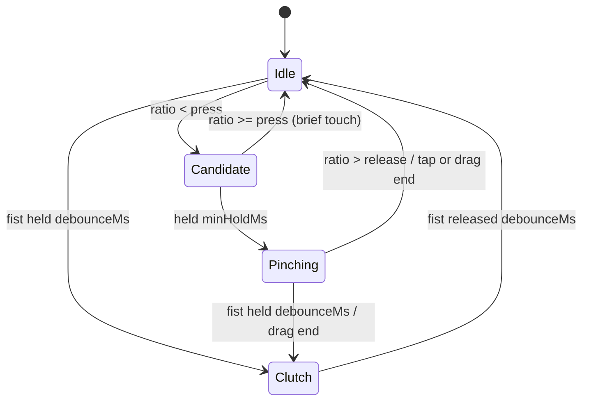
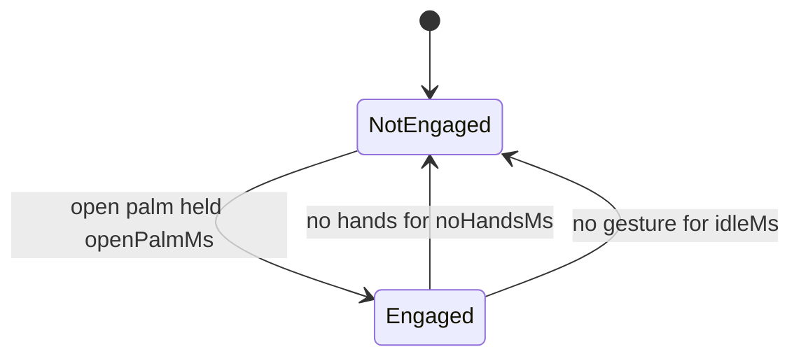

# Gestures

AEX turns smoothed hand and head tracking into a small gesture vocabulary. Everything is recognised in the perception worker, right after smoothing, and published as one ordered event stream that navigation, the tool palette and agent approvals subscribe to.

## Vocabulary

| Gesture | How to do it | Event |
|---|---|---|
| Engage | Hold an open palm toward the camera for a moment | `engaged` |
| Pinch tap | Touch thumb and index briefly, keep the other fingers relaxed open (like an OK sign) | `pinch.tap` |
| Pinch drag | Pinch and move, then open the fingers | `pinch.drag.start`, `.update`, `.end` |
| Clutch | Close the hand into a fist; move; open again | `clutch.start`, `clutch.end` |
| Two-hand pinch | Pinch with both hands; spread, bring together, move or rotate them | `twohand.start`, `.update`, `.end` |
| Nod | Nod your head down and up | `head.nod` |
| Shake | Shake your head left and right | `head.shake` |

Nothing but engagement produces a command until you are engaged. Lowering both hands out of view, or not gesturing for a while, disengages.

**Pinch versus fist.** A pinch is thumb and index together with the other fingers relaxed open. If you fold every finger around the thumb, the hand is a fist, which is the clutch. On recorded footage the two shapes are indistinguishable from hand landmarks, so this is a rule of the vocabulary rather than a tuning choice.

## Thresholds

All values live in `packages/perception/src/gestures/config.ts`; a unit test checks that this table matches it.

| Setting | Value | Meaning |
|---|---|---|
| `engage.openPalmMs` | 300 | Open palm held this long engages |
| `engage.noHandsMs` | 1500 | No hand visible this long disengages |
| `engage.idleMs` | 10000 | No gesture this long disengages |
| `pinch.press` | 0.25 | Thumb-index distance / hand size below this starts a pinch |
| `pinch.release` | 0.35 | Above this, the pinch ends (hysteresis) |
| `pinch.minHoldMs` | 60 | The distance must stay below `press` this long |
| `pinch.tapMaxMs` | 250 | Shorter pinches are taps... |
| `pinch.tapMaxMove` | 0.02 | ...if they moved less than this fraction of the frame width |
| `posture.extended` | 1.35 | Finger tip-to-wrist / knuckle-to-wrist above this: extended |
| `posture.curled` | 1.15 | Below this: curled |
| `posture.thumbSpread` | 0.45 | Thumb tip to index knuckle / hand size above this: thumb spread |
| `posture.palmFacing` | 0.5 | Palm normal toward the camera (-1 to 1) above this: facing |
| `clutch.debounceMs` | 100 | A fist must hold (or be released) this long |
| `head.windowMs` | 1200 | Nod and shake are detected within this window |
| `head.nodDegrees` | 8 | Minimum pitch swing per nod reversal |
| `head.shakeDegrees` | 10 | Minimum yaw swing per shake reversal |
| `head.reversals` | 2 | Reversals needed in the window |
| `head.cooldownMs` | 1000 | After a nod or shake, head motion is ignored this long |

Hand size is the distance from the wrist to the middle-finger knuckle. The pinch distance is measured in the camera image (corrected for aspect ratio): on recorded footage that separates pinched hands (0.12-0.17) from open ones (about 1.2) far better than MediaPipe's 3D world coordinates. Finger extension and palm direction use the 3D world coordinates.

## State machines

Per hand:

Inside Pinching, the drag start is held back until the pinch lasts longer than `tapMaxMs` or moves more than `tapMaxMove`. Released before either, it is a tap. When both hands pinch, the two-hand stream takes over and single-hand drags pause; when one hand lets go, the other continues as a fresh drag.

Engagement:

Disengaging ends any running drag or two-hand gesture first, so consumers never see a dangling drag.

Head: pitch and yaw over the last `windowMs` go through a zigzag filter. A reversal counts once the head has swung back by more than the threshold, and `reversals` of them make a nod (pitch) or a shake (yaw). Turning your head to look somewhere and staying there is a single movement, not a shake.

## In the HUD

The Gestures card shows whether you are engaged, what each hand is doing (open palm, pinch, drag, clutch), the last gesture (held on screen for 1.5 s so a quick tap is readable), the last head gesture, and the recogniser's time per frame.

## Testing

Unit tests replay landmark fixtures recorded from real clips (`test-assets/landmarks`, made with `node scripts/export-landmarks.mjs`) and synthetic sequences built from real template hands. End-to-end tests play recorded clips through Chromium's fake camera.
