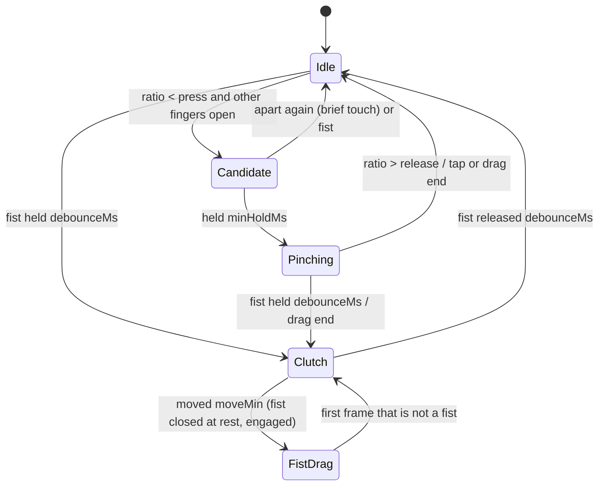
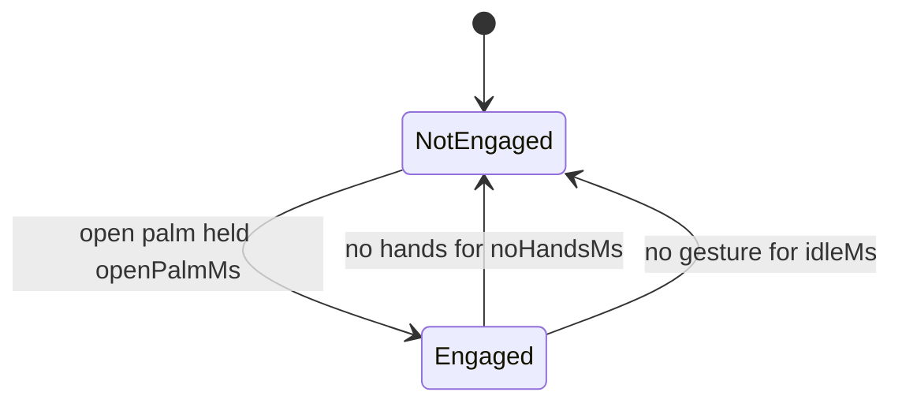

# Gestures

HAI turns smoothed hand and head tracking into a small gesture vocabulary. Everything is recognised in the perception worker, right after smoothing, and published as one ordered event stream that navigation, the tool palette and agent approvals subscribe to.

## Vocabulary

| Gesture | How to do it | Event |
|---|---|---|
| Engage | Hold an open palm toward the camera for a moment | `engaged` |
| Pinch tap | Touch thumb and index briefly, keep the other fingers relaxed open (like an OK sign) | `pinch.tap` |
| Pinch drag | Pinch and move, then open the fingers | `pinch.drag.start`, `.update`, `.end` |
| Long pinch | Pinch and keep the hand still for a moment: hold to talk about what is under the hand ([below](#hold-to-talk)). Held without a word, it shows the hand's ring: steer and release | `pinch.hold` |
| Clutch | Close the hand into a fist; open again. A fist closed while the hand was dragging stays a clutch: move your hand back without moving the view | `clutch.start`, `clutch.end` |
| Fist drag | Close the hand into a fist at rest, then move it | `fist.drag.start`, `.update`, `.end` |
| Two-hand pinch | Pinch with both hands at once; spread, bring together, move or rotate them | `twohand.start`, `.update`, `.end` |
| Nod | Nod your head down and up | `head.nod` |
| Shake | Shake your head left and right | `head.shake` |
| Stop | Clench both hands into fists for a moment, then open both palms toward the camera | `hands.stop` |

Nothing but engagement produces a command until you are engaged. Lowering both hands out of view, or not gesturing for a while, disengages.

**Both hands are equal.** Each hand taps, drags, scrolls and presses buttons on its own; a silent long pinch shows a different ring per hand (the action ring for your dominant hand, the reference ring for the other). Two pinches are one two-hand gesture only when they start together (or while neither hand is doing something of its own): a hand that holds a ring open, or is already dragging, keeps its gesture, and the other hand's pinch is its own tap or drag.

**Stop needs two fists first.** Open palms alone never stop anything, so showing both hands to the camera is safe. Close both hands into fists (the HUD then says to open them), and open both palms within a second to stop the agents.

**Pinch versus fist.** A pinch is thumb and index together with the other fingers relaxed open. If you fold every finger around the thumb, the hand is a fist, which is the clutch. On recorded footage the two shapes are indistinguishable from hand landmarks, so this is a rule of the vocabulary rather than a tuning choice.

## Changing what gestures do

**Settings > Gestures** lists every gesture with how to make it and what it does, each in a dropdown of the actions that gesture can take. One-hand gestures (tap, long pinch, drag, fist) have a dropdown for each hand. The bridge keeps your choices in `.hai/settings.json`, so they follow the workspace across browsers and restarts. **Reset to defaults** puts everything back. While you try a gesture, its row lights up when the camera sees it, which shows which gestures work well for you.

| Gesture | Default | Can also |
|---|---|---|
| Open palm | Engage | (fixed) |
| Pinch tap (each hand) | Use the active tool | Select what it points at (whatever the tool; a pointer near a model snaps to it), undo, redo, cancel, ask or stop the agent, nothing |
| Long pinch (each hand) | Hold to talk; held silent, the hand's ring (the action ring for the dominant hand, the reference ring for the other) | Open the action ring or the reference ring at once (no listening), select, undo, redo, cancel, ask or stop the agent, nothing |
| Pinch drag (each hand) | Active tool, else orbit | Always orbit, pan the view, nothing |
| Fist drag (each hand) | Pan the view | Orbit the view, nothing |
| Two-hand pinch | Zoom, pan and turn the view | Nothing |
| Fist hold (each hand, kept still for 1.5 s) | Cancel, back to Select | Undo, redo, ask or stop the agent, nothing |
| Nod | Yes: send a spoken request, allow the agent's only waiting approval, open a panel the agent offered, or confirm the tool's question | Undo, redo, cancel, ask or stop the agent, nothing |
| Shake | No: stop a held request sent in the last 1.5 s, discard a spoken request, deny the only waiting approval, skip a panel offer, or cancel | Undo, redo, cancel, ask or stop the agent, nothing |
| Two fists, then open hands | Stop the agents | Undo, cancel, nothing |

While both hands are fists, neither hand's fist action runs, so the stop never also cancels the tool. Whichever gesture is set to "Yes" or "No" answers what waits for it in a fixed order, and only one thing per gesture: a "no" first stops a held request sent in the last 1.5 s, then a spoken request under review, then an approval card (when exactly one waits), then a panel offer (when it is the only thing waiting), and only then the tool's question. Allowing a card and opening a panel need you to be engaged, so a stray nod never does either. A shake that answers a card or an offer never also cancels the active tool.

## Hold to talk

A long pinch says "this" and listens. Pinch on what you mean and keep the hand still: a ring fills around the pointer, and when it is full (`pinch.holdMs`) the hold fires.

- **What "this" is.** The element under the pinch (the pointer snaps to the nearest model in reach), else the point the drawing aids find there (an end, a middle, a centre, at any height), else the point on the ground. It is outlined in the colour of the hand, or marked with a ring and the aid's name, until you let go.
- **Listening.** The microphone opens and stays open only while you hold. The pointer shows a microphone and a chip beside the hand says what is happening: listening, then writing it down. Pauses do not end it: say "copy this", wait, say "there". Nothing opens the agent panel.
- **Pointing while you speak.** Once you are speaking, the hand points. An element it rests on for 300 ms is captured as a reference, and a point it rests on away from any element is captured as a point, marked P1, P2 and so on (the drawing aids place it, so it lands on an end or a middle when one is near). So "copy this there" and "a canopy from here to here" mean exactly where your hand went.
- **Letting go sends it.** What you said goes to the agent at once, with no countdown: the hold was the deliberate act. A name at the start still chooses who does it ("Architect, add a stair core here"), and a tool's name alone picks the tool instead ([voice.md](voice.md#tool-names)). For 1.5 s the chip reads **Sent - shake to stop**: a head shake then stops that request (its turn and anything it handed out) and nothing else.
- **Saying nothing shows the ring.** If you have not spoken 0.6 s after the hold fired, the hand's ring fades in around it. Move toward a tool and let go to choose it, as before, or let go in the centre for nothing. You need not wait for the ring: a flick before you speak highlights the slot at once. Speech always wins: once you speak the ring goes, and your hand points.
- **Holding something keeps holding it.** A long pinch on a button presses the button; on the section plane, on an element you are moving, or while drawing a wall or a sketch, it keeps holding that. None of these listen.

The speech detector and the speech model load when you first engage, so the microphone is live about 50 ms after the hold fires (the very first hold of a session also opens the audio device, about 0.4 s). It stops within about 20 ms of letting go. To have a long pinch open a ring at once, without listening, set it to **Open the action ring** or **Open the reference ring** above. The Detection card counts long pinches, those with speech, flicks per ring and those let go with nothing chosen; the counts stay on this computer.

## Hands in a generated panel

When the agent offers a panel and you open it, both hands work inside it as they do anywhere else on screen: point at a control (the pointer snaps to the panel as a whole, and stays where your hand is inside it), then pinch.

| Control | By hand |
|---|---|
| Button | A pinch presses it when you let go, like a click |
| Checkbox, radio button | A pinch toggles or selects it |
| Range (slider) | Pinch on the track to set it there, or pinch and drag along it: it moves exactly as it does with the mouse, and the model follows live |

Dropdowns (`select`), text fields and text selection need the mouse and keyboard, so a panel written for hands uses buttons and sliders. The panel's own **Done** and **Close** are ordinary buttons and work the same way, and **Escape** closes the panel from the keyboard (the model goes back as it was). The agent is told which controls work by hand when it writes the panel, so ask for "a panel I can use by hand" if you want one made for it.

## Thresholds

All values live in `packages/perception/src/gestures/config.ts`; a unit test checks that this table matches it.

| Setting | Value | Meaning |
|---|---|---|
| `engage.openPalmMs` | 300 | Open palm held this long engages |
| `engage.noHandsMs` | 1500 | No hand visible this long disengages |
| `engage.idleMs` | 10000 | No gesture this long disengages |
| `pinch.press` | 0.168 | Thumb-index distance / hand size below this counts as the fingertips touching |
| `pinch.release` | 0.2 | Above this, the pinch ends (hysteresis) |
| `pinch.minHoldMs` | 60 | The fingertips must keep touching this long before a pinch starts |
| `pinch.tapMaxMove` | 0.04 | A pinch released before `holdMs` that moved less than this fraction of the frame width is a tap; moving this far starts a drag |
| `pinch.othersMin` | 1.3 | Mean extension of the middle, ring and little fingers needed for a pinch to start |
| `pinch.lostGraceMs` | 250 | A pinching hand lost by tracking for less than this is still pinching |
| `pinch.holdMs` | 800 | A pinch held this long... |
| `pinch.tapOpen` | 0.3 | A tap counts only once the fingers open past this ratio... |
| `pinch.tapOpenMs` | 200 | ...within this long of letting go, so a hand that stays half closed after nearly pinching never clicks |
| `pinch.holdMaxMove` | 0.04 | ...while moving less than this fraction of the frame width is a hold (long pinch) |
| `posture.extended` | 1.35 | Finger tip-to-wrist / knuckle-to-wrist above this: extended |
| `posture.curled` | 1.15 | Below this: curled |
| `posture.thumbSpread` | 0.45 | Thumb tip to index knuckle / hand size above this: thumb spread |
| `posture.palmFacing` | 0.5 | Palm normal toward the camera (-1 to 1) above this: facing |
| `clutch.debounceMs` | 100 | A fist must hold (or be released) this long |
| `clutch.moveMin` | 0.03 | A fist that moves this fraction of the frame width from where it closed is a fist drag (it pans) and never a hold (cancel) |
| `twoHand.startWindowMs` | 300 | Two pinches that begin within this of each other are a two-hand pinch; otherwise a hand that already holds or drags keeps its own gesture |
| `stop.fistsMs` | 250 | Both hands fists together this long (while engaged) arm the stop... |
| `stop.openMs` | 1000 | ...and both palms opened within this of the fists opening stop the agents |
| `head.windowMs` | 1200 | Nod and shake are detected within this window |
| `head.nodDegrees` | 8 | Minimum pitch swing per nod reversal |
| `head.shakeDegrees` | 10 | Minimum yaw swing per shake reversal |
| `head.reversals` | 2 | Reversals needed in the window |
| `head.cooldownMs` | 1000 | After a nod or shake, head motion is ignored this long |

Hand size is the distance from the wrist to the middle-finger knuckle. The pinch distance is measured in the camera image (corrected for aspect ratio), which separates touching fingertips from open hands (about 1.2) far better than MediaPipe's 3D world coordinates. Finger extension and palm direction use the 3D world coordinates.

**A pinch means the fingertips meet.** The pinch values were set on 135 frames from the test clips, each labelled by eye as touching, near miss or fist (`test-assets/landmarks/pinch-labels.json.gz`, checked by a unit test):

| Hand | Distance / hand size | Other fingers' extension |
|---|---|---|
| Fingertips touching, held | 0.12-0.15 | 1.38 or more |
| Near miss, a visible 1-3 mm gap | 0.18-0.21 | any |
| Fist, or closing into / opening from one | as low as 0.11 | 1.17 or less |

So `press` sits between touching and a near miss, with a 5% buffer above 0.16 so fingertips that only just meet still count (53 of the 55 labelled touches pinch; the one near miss closest to touching, at 0.166, falls inside the buffer), and `othersMin` keeps the thumb from triggering a pinch as it passes the index on the way into or out of a fist. A touch that turns into a fist before `minHoldMs` is dropped.

**Tracking loss.** A hand sweeping fast or passing over the face is often lost for a few frames (motion blur, skin against skin). A pinch survives a loss shorter than `lostGraceMs`, so a drag carries on from wherever the hand reappears, and a pinch interrupted by a loss never counts as a tap, because the fingers were not seen opening. Without this, pinching and sweeping a hand across the face fired a stray tap (found on a recorded clip, `test-assets/clips/hand-cross-face.mp4`).

## State machines

Per hand:

A fist that closed at rest, and then moves `clutch.moveMin` (3% of the frame width) from where it closed, is a **fist drag**: it starts at the closing position, so no movement is lost to the threshold, and it follows the centre of the palm (the wrist and the four knuckles), which stays put as the fingers curl, where the fingertips travel 7 to 10% of the frame width on the way into a fist. It ends at the first frame that is no longer a fist, so the hand opening adds no movement. A fist closed while the hand was dragging, closed while not engaged, or closed while the other hand is a fist too (the stop gesture) is only a clutch until it opens. A fist that moves is never a hold: the fist hold (cancel) needs it still.

Inside Pinching, a drag starts once the pinch moves more than `tapMaxMove`, or when it becomes a hold. Released still before that, it is a tap however long it lasted: deliberate pinches on the recorded clips last 450 to 650 ms and drift less than 1% of the frame width, so a time limit turned real taps into tiny drags (and nothing got selected). When both hands pinch together, the two-hand stream takes over and single-hand drags pause; when one hand lets go, the other continues as a fresh drag. A pinch that comes later, while the other hand holds a ring or drags, stays a gesture of its own.

Engagement:

Disengaging ends any running drag or two-hand gesture first, so consumers never see a dangling drag.

Head: pitch and yaw over the last `windowMs` go through a zigzag filter. A reversal counts once the head has swung back by more than the threshold, and `reversals` of them make a nod (pitch) or a shake (yaw). Turning your head to look somewhere and staying there is a single movement, not a shake.

## In the HUD

The Gestures card shows whether you are engaged, what each hand is doing (open palm, pinch, drag, clutch), "Open both hands to stop" while both fists are held, the last gesture (held on screen for 1.5 s so a quick tap is readable), the last head gesture, and the recogniser's time per frame.

The Detection card shows how reliably tracking works and how fast it responds:

- **Detected**: for each hand and the face, the share of frames in the last 5 seconds it was found in, with a strip of those frames (pinched frames marked) so dropouts are visible.
- **Pinch**: for each hand, a meter of the thumb-index distance with the touch (`press`) and release marks, and whether the fingertips touch. When they touch but the other fingers are curled, it says so: that hand is making a fist, not a pinch.
- **Taps / drags / two-hand**: pinch gestures recognised since the camera started.
- **Response**: the 90th percentile over the last 3 seconds of camera to gesture (from the camera capturing a frame to its gestures reaching the page) and gesture to render (to the viewer drawing the change).

## Testing

Unit tests replay landmark fixtures recorded from real clips (`test-assets/landmarks`, made with `node scripts/export-landmarks.mjs`) and synthetic sequences built from real template hands. End-to-end tests play recorded clips through Chromium's fake camera.
